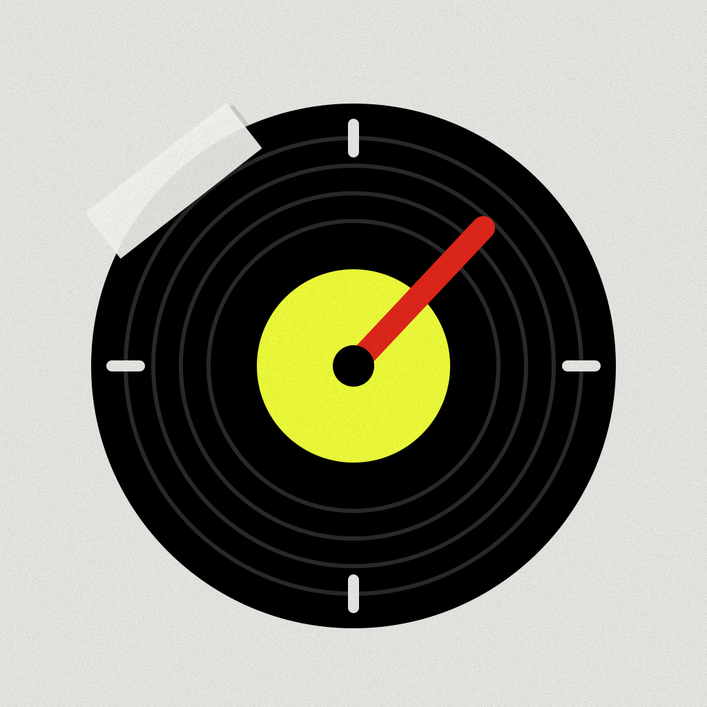
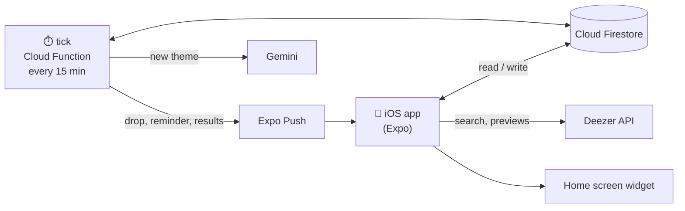

<div align="center">



# Angelus

**A daily music ritual for small groups of friends.**

One theme a day. One hour to answer with a song. Your friends vote. The winners make the playlist.

[](LICENSE)
[](#)
[](https://docs.expo.dev/versions/v57.0.0/)
[](https://reactnative.dev)
[](https://www.typescriptlang.org)
[](https://firebase.google.com)
[](https://ai.google.dev)
[](#contributing)

[How it works](#how-it-works) · [Features](#features) · [Architecture](#architecture) · [Getting started](#getting-started) · [Contributing](#contributing)

</div>

---

## How it works

1. **The drop.** Once a day, at a random time between 10:00 and 19:45 (Paris time), everyone receives the
   same theme by push notification, for example _« Le son que ton chat écoute en cachette »_ or
   _« Ce que chante ton frigo la nuit »_.
2. **One hour to post.** Search a track, listen to the preview, post it. A reminder goes out 45 minutes
   after the drop to those who haven't posted. Late posts are allowed but marked as late.
3. **The vote.** Each member votes for their favourite track in their group.
4. **The playlist.** The next morning at 9:00, results go out and the winners are added to the group's playlist.

> The app UI is in French.

## Features

- 🎲 **Daily AI theme**: generated by Gemini, never repeating the last 60 themes, with a hand-written fallback list
- ⏰ **Random drop time** with push notifications and a reminder
- 🔎 **Track search and 30-second previews** through the Deezer API
- 👥 **Groups** joined by scanning a QR code or opening an invite link
- 🗳️ **Votes and a shared playlist** built from each day's winners
- 📱 **Home screen widget** showing today's theme, the time left and who has posted
- 🍎 **Sign in with Apple**

## Tech stack

| Layer | Tech |
| --- | --- |
| Mobile app | [Expo SDK 57](https://docs.expo.dev), [Expo Router](https://docs.expo.dev/router/introduction/), React Native, [Skia](https://shopify.github.io/react-native-skia/), Reanimated |
| Widget | [`expo-widgets`](https://docs.expo.dev/versions/v57.0.0/sdk/widgets/) + `@expo/ui` (SwiftUI) |
| Auth | Firebase Auth (Sign in with Apple) |
| Database | Cloud Firestore, secured by [`firestore.rules`](firestore.rules) |
| Backend | Cloud Functions for Firebase (Node 22, `europe-west1`) |
| Notifications | Expo push notifications |
| Music | Deezer public API |
| Themes | Google Gemini via `@google/genai` |

## Architecture



The whole daily cycle is driven by a single scheduled function, [`functions/src/tick.ts`](functions/src/tick.ts).
Every 15 minutes it looks at the current state and decides what to do:

| Action | When |
| --- | --- |
| `create` | No day exists yet for today: pick a theme and a random drop time |
| `drop` | The drop time has passed: open the day and notify everyone |
| `remind` | 45 minutes after the drop: notify those who haven't posted |
| `close` | A past day is still open: count the votes and fill each group's playlist |
| `results` | 9:00 the next day: send the results |

The decision logic is a pure function ([`schedule.ts`](functions/src/schedule.ts)), so it is easy to read and reason about.

### Data model

```
users/{uid}
pushTokens/{uid}
days/{date}                       theme, dropAt, status (pending → live → closed)
  ├─ posts/{uid}                  the track each user posted
  └─ presence/{uid}
groups/{gid}                      name, ownerId, memberIds
  ├─ days/{date}/votes/{uid}
  └─ playlist/{date_uid}          daily winners
```

## Project structure

```
.
├── app/               # Screens (Expo Router)
├── src/
│   ├── hooks/         # React hooks (Firestore subscriptions, …)
│   ├── lib/           # Firebase, data access, dates, Deezer, audio player
│   ├── ui/            # Paper-styled UI components
│   └── widgets/       # Home screen widget
├── functions/         # Cloud Functions (the `tick` scheduler)
├── plugins/           # Expo config plugins
├── firestore.rules    # Security rules
└── app.json           # Expo config
```

## Getting started

### Prerequisites

- Node.js 22+
- Xcode and an Apple Developer account (Sign in with Apple, push notifications and widgets need one)
- A [Firebase](https://console.firebase.google.com) project on the Blaze plan (scheduled functions need it)
- The [Firebase CLI](https://firebase.google.com/docs/cli): `npm i -g firebase-tools`
- A [Gemini API key](https://aistudio.google.com/apikey)

### 1. Clone and install

```bash
git clone https://github.com/jean-baptisteAZAN/angelus.git
cd angelus
npm install
```

### 2. Configure Firebase

1. Create a Firebase project and enable **Authentication → Apple** and **Cloud Firestore**.
2. Replace the config in [`src/lib/firebase.ts`](src/lib/firebase.ts) with your project's web config.
3. Point the CLI at your project: `firebase use --add`.
4. In [`app.json`](app.json), change `ios.bundleIdentifier` and `ios.appleTeamId` to your own.

### 3. Deploy the backend

```bash
cd functions && npm install && cd ..
firebase functions:secrets:set GEMINI_API_KEY
firebase deploy --only firestore,functions
```

### 4. Run the app

```bash
npx expo run:ios
```

This builds a development client with the native modules (widget, Apple sign-in, notifications).
Expo Go is not enough.

## Contributing

Contributions are welcome! The project is meant to stay small and easy to read.

1. Fork the repo and create a branch: `git checkout -b feat/my-idea`
2. Commit using [Conventional Commits](https://www.conventionalcommits.org) (`feat:`, `fix:`, `docs:`…)
3. Open a pull request describing what changes and why

Found a bug or have an idea? [Open an issue](https://github.com/jean-baptisteAZAN/angelus/issues).

## License

Released under the [MIT License](LICENSE).

<div align="center">

Made with ♪ by [Jean-Baptiste Azan](https://github.com/jean-baptisteAZAN)

</div>
